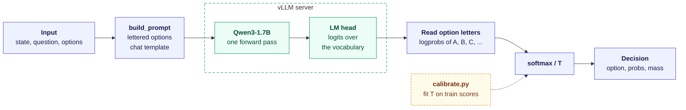

# typed-decisions

Get a typed decision out of a small LLM with a single forward pass.

> **This is not a System One model.** "System One" models, such as TypeSafe AI's Jev, are purpose-built models that return a typed probability distribution over predefined answers in a single forward pass. This project is not one, and does not reproduce Jev or its training. It tries to get the same behaviour (a fast, typed, single-pass decision with probabilities) out of a general-purpose LLM, `Qwen3-1.7B`, by reading the option-letter logits. No weights are trained or modified, and nothing here has been benchmarked against Jev.

> **Purely educational.** This is a personal learning project, built to understand single-pass LLM readouts, calibration and vLLM serving. It is not production software and is not intended for real decisions.

A multiple-choice question is shown with lettered options, and the logits of the option letters at the first answer position are read directly. The result is a probability for every option instead of free text that has to be parsed. A temperature fitted on held-out data makes those probabilities trustworthy.

```python
from typed_decisions.backends import TransformersScorer
from typed_decisions.decide import decide

d = decide(
    TransformersScorer(),
    "The app crashed and I lost my order, I want my money back.",
    "Is the customer asking for a refund?",
    ["yes", "no"],
    temperature=8.5,  # from scripts/calibrate.py
)
d.option, d.probs, d.mass  # ("yes", [0.918, 0.082], ~1.0)
```

`mass` is the total probability the model puts on the option letters before renormalising. Values well below 1 mean the prompt is not producing a letter.

## Architecture



Two scorers share the same prompt and the same readout, so `decide()` does not care which one it gets:

- `VllmScorer` sends the prompt to the server above and reads the top-100 log-probabilities.
- `TransformersScorer` runs the same model in-process and reads the raw logits of the option letters directly.

There is **no classification head**. The model's own LM head already scores every token, and the readout keeps only the rows for the option letters. Nothing is trained; the only fitted parameter is the scalar temperature `T`, fitted offline on held-out train scores.

## How it works

1. `build_prompt` renders the question, lettered options and text through the chat template, ending exactly where the assistant's answer would begin.
2. One forward pass gives logits over the vocabulary. Only the last position is used, and only at the option-letter token ids.
3. A softmax over those logits, divided by a fitted temperature, gives calibrated option probabilities.

Raw softmax scores from an instruction-tuned model are badly overconfident, so step 3 matters (see Results).

## Setup

Requires Python 3.14, [uv](https://docs.astral.sh/uv/) and a CUDA GPU (developed on a 6 GB laptop GPU).

```bash
uv sync
```

## Usage

Run `decide()` on a multi-class and a yes/no question:

```bash
uv run python scripts/example_decide.py
```

Score examples with plain transformers and report accuracy. Raw scores are saved to `results/transformers_<split>.npz`:

```bash
uv run python scripts/eval_transformers.py 1000 train
uv run python scripts/eval_transformers.py 500 test
```

Fit the temperature on train scores and report calibration on test scores (writes `results/temperature.json`):

```bash
uv run python scripts/calibrate.py
```

Score examples through the vLLM server:

```bash
./serve-model.sh                              # terminal 1, separate uv project in vllm-server/
uv run python scripts/eval_vllm.py 500 test   # terminal 2
```

Ask the running server about a single input (uses the fitted temperature if `results/temperature.json` exists):

```bash
uv run python scripts/ask_vllm.py "The app crashed and I lost my order, I want my money back." \
  -q "Is the customer asking for a refund?" -o yes -o no
```

The test case is [Banking77](https://huggingface.co/datasets/mteb/banking77) restricted to 20 intents (seeded sample), scored with `Qwen/Qwen3-1.7B`.

## Results

500 test examples, 20 options (chance is 0.05). Temperature fitted on 1000 train examples.

| | transformers |
|---|---|
| Accuracy | 0.454 |
| Mean option mass | 1.000 |

**Calibration.** One fitted temperature (T = 8.5) leaves accuracy unchanged and fixes the confidence:

| | ECE | NLL |
|---|---|---|
| Raw softmax | 0.516 | 9.996 |
| Temperature scaled | 0.066 | 2.075 |

## Limitations

- At most 26 options, because each option is one letter and one token.
- vLLM returns only the top 100 log-probabilities. A letter outside the top 100 is scored at the lowest returned value, which is an upper bound on its true score.
- Accuracy is modest. This is a 1.7B model on 20 fine-grained banking intents, and several intents overlap. The point of the project is the typed, calibrated readout, not state-of-the-art classification.
- Calibration is one scalar. It does not correct a preference for particular letters.

## Layout

- `src/typed_decisions/data.py`: Banking77 loading and intent subsetting
- `src/typed_decisions/prompt.py`: chat prompt that ends where the answer begins
- `src/typed_decisions/readout.py`: single forward pass returning option scores
- `src/typed_decisions/backends.py`: `TransformersScorer` and `VllmScorer`
- `src/typed_decisions/calibrate.py`: temperature scaling, ECE, NLL
- `src/typed_decisions/decide.py`: `decide()` and the `Decision` result
- `scripts/`: evaluation, calibration, vLLM and example scripts
- `serve-model.sh`, `vllm-server/`: vLLM server, kept in its own project so its dependencies stay separate
- `tests/`: unit tests that need no GPU

## Development

```bash
uv run ruff check . && uv run ruff format --check .
uv run mypy src scripts tests
uv run pytest
```
